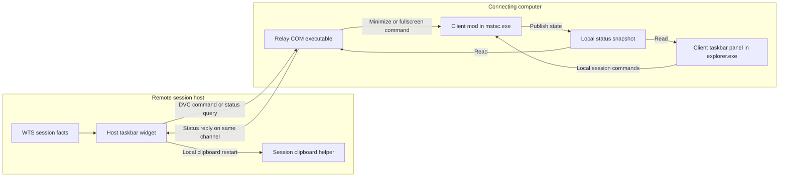

# Repository review and proposed direction

Review scope: product purpose, repository structure, runtime architecture,
maintenance costs, and feature planning against the checked-in source at
`13430fd`. This is a source and documentation review, not a new runtime test or
an exhaustive security audit. Proposed features below are not implementation
commitments. Existing decisions remain in
[DECISIONS.md](.raiden/state/DECISIONS.md); verification dispositions remain in
[OPEN_LOOPS.md](.raiden/state/OPEN_LOOPS.md).

## 1. Mission: broader than the toolbar, bounded by the RDP session

**Proposed mission statement:**

> Make Windows Remote Desktop sessions easier to understand, control, and
> recover, through lightweight tools that stay close to the session and act
> predictably under the user's control.

The taskbar toolbar is the primary interface today. The product's purpose is
the RDP workflow around it. That distinction permits an on-demand diagnostic
script, a session history file, or a host sleep-request option without requiring
each to become another permanent toolbar button.

The original README and HANDOFF describe a narrower initial ambition: show
remote-session state on the client's taskbar. The implementation has grown into
tools on both sides, with remote-to-local controls and local-state replies.
The local panel still mostly presents facts measured by the local RDP client;
it is not a general dashboard of remote host health.

The existing separation from Hide RDP Connection Bar remains valuable: that
project has a narrow UI purpose; this repository includes session control,
process recovery, registry registration, IPC, and a companion executable.
Personal use remains the baseline. General distribution is a separate maturity
step, not a reason to add an installer service or a management platform now.

Three useful product areas fit the mission:

- **Understand:** identify the session and explain unavailable or stale state.
- **Control:** expose deliberate, correctly targeted session actions.
- **Recover:** provide small, bounded remedies for specific RDP problems.

General machine administration, credential management, remote shell execution,
and fleet monitoring have different ownership and trust costs. They should
not enter through an innocuous-looking new toolbar button.

## 2. What the repository contains

| Area | Responsibility | Runtime/deployment implication |
|---|---|---|
| `taskbar-integration/client/` | One Windhawk C++ mod with separate `mstsc.exe` and `explorer.exe` branches | Installed on the connecting computer; the RDP branch operates the session and the Explorer branch draws the local panel |
| `taskbar-integration/host/` | Separate Windhawk mod in the remote session's `explorer.exe` | Installed on the machine being connected to; reads WTS session facts and supplies remote-side controls |
| `dvc-plugin/relay/` | Native COM LocalServer executable and registration helper | Installed/registered on the client; bridges the RDP virtual channel and local client mod |
| `dvc-plugin/probe/` | Earlier activation experiment, including a standalone host trigger | Historical reference and reproducible mechanism test; not another required production component |
| `taskbar-integration/compile-check.ps1` | Compiles and links both mods; checks known settings-block formatting failures | Uses Windhawk's compiler; its settings checker is deliberately narrower than a full YAML validator |
| `dvc-plugin/relay/build.ps1` | Builds the standalone relay | Separate build from the Windhawk mods; no release signing or installer pipeline is implemented here |
| `README.md`, component READMEs | Usage, installation, architecture | Manual source installation for the mods; build/register the relay separately |
| `ROADMAP.md`, `EXPANSION_RESEARCH.md`, `HANDOFF.md` | Planning and historical rationale | Several passages describe earlier architectures; this review supplies the new proposal without erasing that history |
| `.raiden/` | RAIDEN Instance governance and continuity | Development control plane, not a runtime dependency of the toolkit |

The production mod files target x86-64. Extra architecture choices in the relay
build script do not establish end-to-end toolkit support for those architectures.
The taskbar integration depends on Windows 11 XAML/taskbar internals and symbol
hooks. Support should be described in terms of combinations actually tested,
rather than inferred from a successful compilation.

## 3. How the working parts communicate

**Local operation:** the mstsc branch hides the connection bar, provides the
optional overlay, handles session actions, watches window responsiveness, and
writes a status snapshot. The Explorer branch reads that snapshot and sends
commands through a separate message window. Local controls work without the
remote host widget or relay installation.

**Remote operation:** the host widget reads its own session's WTS state. Its
Disconnect and Restart Clipboard actions execute on the host. Minimize and
fullscreen toggle travel through the DVC relay to the client mod. The host
opens a channel for each request, writes, reads a reply, and closes it.

**State:** the client publishes a versioned 192-byte snapshot, normally about
once per second. Local readers reject missing, incompatible, or stale state;
the freshness threshold is four seconds. The host polls client state every
three seconds and uses a ten-second freshness threshold for its cached view.
Host WTS notifications have a thirty-second fallback refresh. These small
payloads do not establish low total overhead: channel creation, threads,
file operations, and logging also matter.

**Limits:** DVC replies already carry client state back to the host. They do
not provide arbitrary client-initiated host commands. A local toolbar button
that restarts remote clipboard recovery would still need new request routing,
host-side command handling, validation, and two-machine tests.

The existing code uses a local shared secret, relay executable path checks,
command allowlists, and RDP/session gates. Those are useful constraints, but
are not evidence of a hardened boundary against hostile code running as the
same user. Expansion should retain the narrow commands and current privilege
boundary; broader control requires its own review.

## 4. Existing capabilities and evidence

The client panel offers minimize, restore, fullscreen/windowed toggle,
disconnect, and opt-in reconnect. It also shows session identity/state and
tooltips for local input idle, connection quality when reported, and a hung
window. The optional floating overlay is a second presentation surface.
Force reconnect requires an explicit user action; it is not an automatic
recovery policy.

The host panel provides connecting-client identity, WTS state, disconnect,
client minimize/fullscreen control, and clipboard-helper restart. Clipboard
presence is deliberately limited information: a running process does not prove
copy-and-paste is healthy.

Per-monitor placement and live theme handling are already implemented.
The thumbnail toolbar was removed because it duplicated existing controls.
Restoring it would reverse a useful simplification unless a new need emerges.

D-41 records operator verification of the current combination. That is valuable
real-use evidence, but it does not establish every failure case or OS build.
In particular, the older quality-event record says the event subscription
worked but actual network-quality reports had not arrived. Broad subsequent
verification does not supply a captured quality sample. Keep the honest
unknown state and obtain specific evidence before treating quality telemetry
as a dependable foundation for new features.

The repository has build/link checks and manual test records. No automated
production behavior test suite or CI workflow was found among tracked files.
This review did not rebuild, load mods, register a relay, or exercise a live
session.

## 5. Findings that should shape expansion

These are source-based findings; operational consequences still need focused
tests. They do not invalidate the recorded successful single-session use.

| Finding | Evidence in source/docs | Planning consequence |
|---|---|---|
| Session identity is not consistently bound to actions | Client `GetLocalWidgetStatusFilePath` uses one shared filename; `SendLocalWidgetCommand` and relay `ForwardFirstByte` select a message window by class name. The snapshot has a PID, but command selection does not bind to it | With two mstsc instances, displayed state and action target can diverge. Start with ambiguity detection; require explicit instance routing before a session selector |
| A relay reply is not proof that the requested action succeeded | `ForwardFirstByte` returns no result; `OnDataReceived` builds a status reply even if forwarding failed; host `SendRelayCommandAsync` logs delivery confirmation on a valid reply | Distinguish transport receipt, command acceptance, and observed outcome. Never automatically retry a fullscreen toggle after an ambiguous timeout |
| Normal status polling generates unbounded relay log traffic | `RelayLog` opens/appends a file for each message; channel creation, query, reply and closure log on routine requests; no rotation is implemented | Bound retained logs and gate repetitive success messages before adding history or more telemetry |
| Relay shutdown has no implemented last-client exit path | `Main.cpp::RunServer` waits indefinitely on a shutdown event; only the console handler signals it. `g_lockCount` is not used to trigger shutdown | Verify the process after the final disconnect and implement deliberate COM server lifetime management if it remains. Do not rely on the comment claiming COM reaps it |
| Host unload assumes detached work finishes within a fixed wait | `Wh_ModUninit` waits up to five seconds per worker category, then returns without requiring zero workers; clipboard waits can repeat for multiple matches | Resolve worker ownership/unload completion before adding more asynchronous repairs; a bounded wait alone is not a lifetime guarantee |
| Expiration does not itself schedule a host UI update | `GetClientView` applies staleness when called; failed polls do not refresh UI, and unchanged WTS state need not trigger repaint | Test relay loss while fullscreen state is shown. Refresh on the known-to-unknown transition if the visible label remains stale |
| Internal taskbar integration remains a maintenance cost | Both mods hook `TaskListButton::UpdateVisualStates` and locate XAML nodes | Add an on-demand compatibility diagnostic and record tested Windows builds; avoid growing unrelated work inside Explorer |
| Same-machine client/host panels can overlap | Existing ROADMAP design question and both default taskbar placements | Provide explicit role labels and non-overlapping placement before advertising nested/jump-host workflows |
| Documentation mixed past and present at the review baseline | HANDOFF said production parts were unbuilt; README called the main panel an alternative; older research denied a return path that now exists | This pass marks historical material, corrects selected README statements, and repairs roadmap decision links; a full historical rewrite is unnecessary |

Reference implementations for the findings are
[client mod](taskbar-integration/client/rdp-session-toolkit-taskbar-client.wh.cpp),
[host mod](taskbar-integration/host/rdp-session-toolkit-taskbar-host.wh.cpp),
[relay callbacks](dvc-plugin/relay/plugin/RdpRelayPlugin.cpp), and
[relay entry point](dvc-plugin/relay/plugin/Main.cpp).

Microsoft documents explicit reference-count-based local-server cleanup;
automatic process exit should not be assumed from releasing a plugin object.
[COM server lifetime reference](https://learn.microsoft.com/en-us/windows/win32/api/combaseapi/nf-combaseapi-coreleaseserverprocess).

## 6. Feature admission and overhead limits

Admit a feature when it has a named recurring RDP problem, a correct session
target, a clear unknown/failure state, and a bounded maintenance cost. Prefer
existing events and action handlers. Any new timer, worker, channel, persistent
file, privilege requirement, or permanent button needs a specific justification.

Proposed operating limits:

- No new always-running service, database, cloud account, or listening network
  port for the first expansion wave.
- Optional capabilities are off by default and do no feature-specific polling
  or file writes while disabled. Explicitly enabled session policies may react
  to lifecycle events; reconnect, termination, and disconnect stay deliberate.
- Keep routine traffic at or below the existing cadence unless measurement
  demonstrates why faster updates matter. Back off unavailable optional peers;
  do not replace the current short-lived channel with a persistent one merely
  to make the architecture look extensible.
- Never block the taskbar UI on process exit, disk scans, or remote replies.
  Bound concurrency and establish safe worker completion at unload.
- Proposed log budget: one 1 MiB current file plus one 1 MiB rotated file per
  log type; optional connection history has a separate bounded retention rule.
- Preserve the existing primary controls. Rare diagnostic tools start as
  scripts or explicit commands; add a compact secondary menu only if actual
  usage calls for one. Do not widen the toolbar for every feature.
- Record a before/after baseline for idle CPU, private memory, threads,
  handles, log growth, request cadence, and click response on the same machines.
  No numerical CPU or RAM promise is justified by this review alone.

## 7. Ranked expansion candidates

Effort is relative to this repository, including testing and lifecycle work.

| Priority | Candidate | Why it fits | Cost and boundary |
|---|---|---|---|
| First | **On-demand toolkit diagnostics** | Explains missing panel, stale state, relay registration problems, and unsupported combinations | Low–medium; read-only PowerShell report first, no background process or automatic repair |
| First | **Action feedback and peer availability** | Turns silent failed clicks into useful state, using the toolbar already present | Medium; needs a versioned reply result and explicit timeout semantics, not just a new tooltip |
| First | **Multiple-session ambiguity guard** | Prevents a status/action mismatch before offering multi-session support | Medium across local and relay paths; disable ambiguous actions with a clear explanation |
| Next | **Request that the host stay awake during an active RDP session** | Addresses long connected-but-idle work without changing global power settings | Low–medium; host-local opt-in, visible state, release on disconnect/disable/unload, no physical-display request |
| Next | **Bounded host connection history** | Answers when this session connected, disconnected, or changed client | Low–medium; event/change driven, local file, no viewer/database; not a complete security audit trail |
| Later, if needed | **Selected-session support** | Enables real multi-session workflows | High; per-instance snapshots, reliable DVC-to-mstsc binding, PID-reuse protection, selection lifetime, and two-session testing |
| Later, if needed | **Role-aware placement** | Supports a computer that is both an RDP host and client | Low–medium for clear labels/settings; higher for automatic layout coordination |
| Later, if needed | **Existing .rdp file shortcuts** | Reduces repeated navigation to known connections | Low–medium; reuse files and the existing launch checks; no credential store, catalog database, or session manager |
| Hold | **One named remote job-completion signal** | Could make background remote work easier to follow | Medium–high; name the producer and reset behavior first; no general notification interception framework |

The sleep feature must be described as a **request to prevent idle sleep**, not
a guarantee of uninterrupted connectivity. Explicit sleep still takes priority,
and Modern Standby on battery limits these requests. These documented limits
correct the stronger promise in the older expansion research.
[Power request behavior](https://learn.microsoft.com/en-us/windows/win32/api/winbase/nf-winbase-powersetrequest).

Clipboard recovery is already delivered and should not be counted as a new
roadmap win. Clipboard content preservation, broad remote command execution,
automatic reconnect/disconnect, general notification mirroring, and support
for unrelated remote-client implementations are outside this first plan.
Keyboard-capture switching remains a separate investigation because the mod
does not already retain the required RDP control interface for that use.

## 8. Recommended implementation sequence and acceptance gates

### Wave A — make the existing toolkit easier to trust and diagnose

1. Reconcile current-facing docs and establish a production smoke checklist.
   Preserve historical decisions; stop presenting old build notes as current
   limitations. Record component versions and tested Windows combinations.
2. Bound relay logging; verify final-session shutdown; resolve detached-worker
   unload safety and stale-state repaint behavior before adding workers.
3. Add an on-demand diagnostic script reporting local role, component/build
   identity where discoverable, relay registration target/existence, running
   mstsc count, snapshot compatibility/age, and known limitations. A single
   machine's report must not claim to prove the entire DVC path. It must not
   collect clipboard contents, credentials, or the local command secret.
4. Add action feedback with distinct unavailable, rejected, timed-out,
   accepted, and observed-state outcomes where the code can establish them.
   A reply must not claim completed execution solely from message delivery;
   mixed versions degrade explicitly. Coordinate host/relay timeouts and do
   not blindly retry actions that toggle state.
5. Add an ambiguity guard to both local and relay command paths. If the
   session cannot be identified unambiguously, explain why the action is
   disabled. Do not merely compare the displayed hostname.

**Acceptance:** existing controls still work in the verified single-session
setup; missing/disabled/mismatched components produce understandable states;
two mstsc instances cannot silently receive an action intended for the other;
logs stay bounded; Explorer remains responsive; unload completes safely.
Measure idle and failure-path overhead against the baseline.

### Wave B — extend beyond the toolbar with small host utilities

Implement the optional idle-sleep request first **if connected idle work is an
actual workflow here**. Use existing WTS lifecycle observations and a named
power request. Balance acquisition/release, surface failures, handle setting
changes, and keep physical display behavior unchanged. Define lock behavior
explicitly: locking an active session need not cancel an opted-in request.

**Acceptance:** verify active RDP, disconnect, console transition, disable,
unload, explicit sleep, and the target machine's AC/battery behavior. The
setting must not imply it protects work after disconnection.

Then add opt-in host connection history if retrospective connection questions
occur in practice. Log observed transitions with timestamp and timezone,
session ID, state, and optional client name. Mark startup as an observation,
not an invented connect event. Do not log clipboard-helper changes as
connection events. State that missed events during unload or polling cannot
be reconstructed reliably.

**Acceptance:** no repeated entries for unchanged state, bounded rotation,
zero history writes when disabled, sensible reconnect records, no sensitive
content beyond the disclosed session metadata.

### Wave C — expand only around a demonstrated workflow

If simultaneous sessions are common, solve reliable instance routing before
building the selector UI. The relay's out-of-process COM server may serve more
than one activation; assuming its process parent uniquely identifies mstsc is
not a routing design. Require a demonstrated binding from DVC connection to
the correct local session instance. A PID alone needs lifetime validation.

Only then add a session chooser. If simultaneous sessions are uncommon, retain
the ambiguity guard and spend no further complexity here. Role-aware placement
or .rdp shortcuts can be selected independently if they solve a real annoyance.

## 9. Architecture direction

Keep the present components and make their internal responsibilities clearer:
session observation, actions, transport, presentation, and diagnostics. Share
action behavior rather than copying it into each surface. Pin mirrored wire
contracts with meaningful compatibility checks; a struct-size assertion alone
does not detect reordered same-size fields.

Do not introduce a general plugin loader or extension SDK. New utilities can
be independent, on-demand tools until repeated needs justify shared machinery.
The single-file Windhawk installation workflow is useful; splitting mod source
into private headers must account for how users actually install it.

The next useful milestone is a toolkit that explains its own failures, limits
its background costs, and always knows which session an action belongs to.
After that, add one small session utility at a time and retain only features
that earn their ongoing cost.

## 10. Distribution follow-up: one setup executable, retain Windhawk

The subsequent packaging discussion changes the immediate priority: a unified
installer can simplify deployment without first moving the runtime into a new
standalone application. Retaining Windhawk preserves the embedded taskbar panel
and avoids owning a replacement injection/hooking framework. This is a proposed
distribution path, not an implemented installer or an adopted migration decision.

### What was verified

This initial alpha.1 snapshot is superseded for packaging decisions by the
[broader packaging research and probes](PACKAGING_RESEARCH.md), which inspect
alpha.5 and record deployment defects and the remaining validation gates.

- The inspected local installation is Windhawk 1.7.3. Its `command-line.txt`
  documents application lifecycle flags, not a local-mod installation command,
  and it has no `windhawk-cli.exe`.
- Windhawk **2.0.0-alpha.1** introduces the official CLI. Its tagged source
  explicitly implements `mod install --file <path>` for unpublished mod source.
  File installs use the `local@<id>` storage identity and always compile locally.
  Enable/disable/remove and configuration commands are also available.
  [CLI arguments](https://github.com/ramensoftware/windhawk/blob/2.0.0-alpha.1/src/windhawk-core/cli/src/args.rs),
  [local installation implementation](https://github.com/ramensoftware/windhawk/blob/2.0.0-alpha.1/src/windhawk-core/cli/src/commands/mods/install.rs).
- The alpha makes development tools optional, but our source-file install path
  needs those tools. Its smaller default installation must not be advertised
  as the complete disk footprint for this toolkit.
  [Release notes](https://github.com/ramensoftware/windhawk/releases/tag/2.0.0-alpha.1).
- The official mod collection's README requires single-file submissions. This
  review did not establish a blanket policy verdict on companion executables;
  catalog acceptance should not be assumed either way. Our GitHub release need
  not depend on catalog inclusion.
  [Submission requirements](https://github.com/ramensoftware/windhawk-mods#submitting-a-new-mod).

These findings come from local inspection and upstream source, not a tested
installer run. No Windhawk upgrade, mod installation, or relay registration was
performed. The alpha must be treated as a prototype dependency until a chosen
version passes the toolkit's deployment and runtime checks.

### Proposed product experience

One `RdpSessionToolkitSetup.exe` from GitHub Releases, with client, host, and
both component selections described as "connect from this PC", "connect to
this PC", and "both". These are installed capabilities, not permanent runtime
roles. Do not infer future use solely from whether setup currently runs in an
RDP session. Automatic role-aware presentation remains separate runtime work;
the current two panels do not yet coordinate their placement automatically.

| Selection | Components |
|---|---|
| Connect from this PC | Client Windhawk mod and DVC relay registration |
| Connect to this PC | Host Windhawk mod |
| Both | Both mods and relay, with explicit placement configuration until automatic coexistence is implemented |

Setup should reuse a compatible Windhawk installation and detect required
development tools. Per the operator's clarification (D-42), it must never
install or upgrade Windhawk. If prerequisites are missing, stop before writes,
link to official installation instructions, and offer Check again. Install mod
sources through the official local-file path in a disabled state; install the
matching relay at a stable path and register it for the intended Windows user;
then enable only selected components after verification. Machine-level setup
and per-user COM registration must preserve the intended user when elevation
uses different credentials.

Use a version manifest and checksums for the release's components. Preserve
existing settings, detect locally edited copies, and avoid creating a duplicate
of an existing local mod. Own updates to these unpublished mods through toolkit
releases, rather than assuming Windhawk's catalog updater will supply them.
Repair/uninstall should touch only toolkit-owned files, mods, and registration;
leave shared Windhawk installations and unrelated mods in place. Report partial
failure and restore the prior working component set when possible. Do not
terminate live RDP sessions to finish installation.

The installer can exit when finished. It does not require another resident
manager or Windows service. Windhawk remains a separately installed dependency;
bundling or automatically acquiring it is outside the chosen scope.

### Next proof before building an installer UI

In a disposable Windows VM, validate the chosen CLI-bearing version with both
real mod sources: fresh local install, enable, settings preservation on upgrade,
disable, and removal. Confirm compiler availability, actual stored mod IDs,
status-path publication, and relay registration for the correct user. Then
exercise the two-machine command/reply path, failure rollback, and coexistence
with an existing Windhawk installation containing unrelated mods.

If that path passes, wrap it in one setup executable. Until then retain the
documented 1.7.3 manual-install route. Do not silently upgrade existing users to
an alpha or make direct edits to Windhawk's internal registry/file layout the
default installer strategy. A standalone runtime rewrite remains an option
only if independent requirements justify it.
